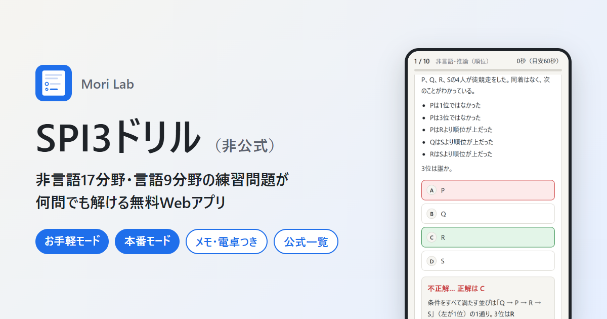

# SPI3ドリル（非公式）

SPI3 の非言語（19分野）・言語（9分野）の練習問題を、その場で自動生成して何問でも解ける Web アプリです。
数値や組み合わせを毎回作り直すので、同じ問題の丸暗記にならず、解き方そのものを練習できます。

**▶ https://spi3.morilab-garage.com/**



> [!NOTE]
> 個人が作った**非公式**の練習アプリです。問題はすべてオリジナル（自動生成）で、実際の試験問題とは関係ありません。SPI は株式会社リクルートの登録商標です。

## 機能

- **お手軽モード**：小さな数で各分野の要点だけを練習。答えるとすぐに正誤・解説・公式が出る。時間制限なし
- **本番モード**：本番に近い数と形式で、1問ごとに制限時間あり。手書きメモと電卓つき、一部は数値の直接入力。解説は最後にまとめて表示
- 分野を選んで集中練習、または非言語／言語／全分野からランダムに出題（5・10・20問）
- **模試**：言語15問 → 非言語15問を本番形式で通して解く。時間はセクションごとの持ち時間制で、成績は履歴に残る
- **苦手分析**：挑戦した分野を正答率の低い順に表示（平均時間と目安つき）。押すとその分野を練習
- 結果画面で分野別の正答率と、間違えた問題の見直し（解説・公式つき）
- 分野ごとの「公式・ポイント一覧」
- 分野ごとの記録（端末内に保存）
- ライト／ダークテーマ（システム設定に追従）
- PWA：ホーム画面に追加（画面内の案内から）・オフラインで利用可

## 出題分野

| 区分 | 分野 |
|------|------|
| 非言語 | 割合、損益算、料金の割引、速さ、仕事算、分割払い、代金の精算、確率、場合の数、集合、推論（順位）、推論（内訳）、推論（勝敗）、推論（平均）、表の読み取り、物の流れ、濃度、年齢算、領域 |
| 言語 | 二語の関係、語句の意味、熟語の成り立ち、語句の用法、文の並べ替え、空欄補充、長文読解、英語、構造的把握 |

## 開発

ビルド不要の静的サイトです（ES Modules）。ローカルでは簡易サーバーで開きます。

```sh
npm start        # http://localhost:8780/
npm test         # 全分野 × 2難易度の問題を大量に生成して、形式の崩れを確認
node tests/sample.mjs kakuritsu 3   # 分野を指定して問題をテキストで表示
```

| ファイル | 役割 |
|----------|------|
| `index.html` | 画面（JSON-LD・OGP・使い方・よくある質問を含む） |
| `css/app.css` | スタイル |
| `js/app.js` | 画面遷移・出題・採点・メモ・電卓・記録 |
| `js/nonverbal.js` / `js/verbal.js` | 問題ジェネレーター（非言語／言語） |
| `js/points.js` | 分野ごとの公式・ポイント |
| `js/util.js` | 乱数・分数などの共通処理 |
| `sw.js` | Service Worker（オフライン対応）。更新時は `CACHE` のバージョンを上げる |
| `manifest.webmanifest` / `icons/` / `og.png` | PWA・SNS 用 |

GitHub Pages（`main` ブランチ直下）で公開しています。push するとそのまま反映されます。

## 紹介ページ

- [制作物ページ（Mori Lab）](https://morilab-garage.com/projects/spi3-drill/)

## ライセンス

[MIT](LICENSE)
